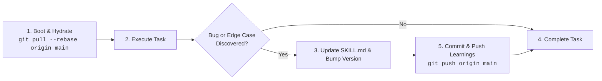

# Pavan Agent Skills Registry (Collective Agent Knowledge Hub)

A centralized, cross-harness skill registry and continuous learning repository for autonomous AI agents (Antigravity, Claude Code, Cursor, Devin, and Hive Agent Swarms).

Whenever any agent in any workspace solves a defect, discovers an edge case, or hardens an operational workflow, it updates the corresponding `SKILL.md` in this repository so all other agents inherit the learning immediately.

---

## 📦 Active Skills Catalog

| Skill Name | Version | Focus Area | Description |
| :--- | :---: | :--- | :--- |
| **`continuous-integration`** | `1.0.0` | Quality Gates & Verification | 4-tier verification engine (statutory math, REST/auth security, clean-slate production audit, headless Playwright E2E), automated VP9 WebM video encoding, and reverse-chronological Playwright HTML reports. |
| **`evidence-collation`** | `1.0.0` | Visual Media Standards | Transcoding raw browser tests to high-efficiency VP9 WebM format, synchronized screenshot capture, and structured `evidence-manifest.json` generation. |
| **`agile-pm`** | `1.0.0` | Project Management | Comprehensive Agile PM for AI teams: sprint planning, GCA-X ticket decomposition, Given/When/Then acceptance criteria, and task board synchronization. |
| **`impeccable`** | `1.0.0` | UI/UX & Design Systems | Frontend interface design, design tokens, typography, motion, accessibility, UX copy, and responsive layouts. |
| **`plan-review`** | `1.0.0` | Architecture & PRD Review | Multi-perspective plan review stress-testing assumptions across Founder/CEO, Tech Lead, and UX angles before coding begins. |
| **`retro`** | `1.0.0` | Continuous Improvement | Sprint and milestone retrospectives, commit analysis, delivery velocity tracking, and process improvement recommendations. |
| **`ship`** | `1.0.0` | Release Management | Production deployment gatekeeper, pre-flight smoke tests, version bumps, changelogs, and edge deployment verification (e.g. Cloudflare Pages). |
| **`llm-resilient-routing`** | `1.0.0` | LLM Gateway & Resilient Routing | Multi-provider fallback chains, Thompson-sampling bandit endpoint ranking, sliding-window RPM/RPD/TPM/TPD rate-limit accounting, and tool-call rescuing. |
| **`hive-agent-orchestration`** | `1.0.0` | Multi-Agent Coordination | Multi-agent office and hive swarm orchestration, single-writer file-based mailboxes, context saturation compacting, 3-tier circuit breakers, and bounded human escalation. |

---

## 🔄 Two-Way Agent Synchronization Protocol

Every participating agent must adhere to the **Collective Learning Protocol**:



### 1. Hydrate Before Starting Work
Before beginning any implementation or verification, pull the latest collective intelligence:
```bash
git -C .agent/skills pull --rebase origin main
```

### 2. Record New Discoveries
When an agent solves a new defect (e.g. non-standard CSV delimiters, Mod-36 checksum rules, or edge timeout handling):
1. Locate the relevant skill folder (e.g., `continuous-integration/SKILL.md`).
2. Add a dated learning entry under `## Learnings & Discovered Edge Cases`.
3. Bump the patch version in the YAML frontmatter.

### 3. Broadcast Learnings
Publish the discovery back to the central hub:
```bash
git -C .agent/skills add .
git -C .agent/skills commit -m "learn(<agent-name>): <description of discovery> [skip ci]"
git -C .agent/skills push origin main
```

---

## 🚀 How to Mount in Any Project Workspace

### Method A: Git Submodule (Recommended)
Add this repo as a submodule in any project:
```bash
git submodule add https://github.com/pavankondapuram/pavan-agent-skills.git .agent/skills
git submodule update --init --recursive
```

### Method B: Standalone Clone
Clone into your user profile for global agent access:
```bash
git clone https://github.com/pavankondapuram/pavan-agent-skills.git ~/.gemini/pavan-agent-skills
```

### Method C: Claude Code / Cursor / Hive Sync
Run the automated multi-harness sync script to mirror to `.claude/skills` and `hive/agents/*`:
```bash
node scripts/syncSkills.mjs
```

---

## 🛡️ Contribution Guardrails
- **Self-Contained**: Each skill folder must contain a standalone `SKILL.md` with valid YAML frontmatter (`name`, `description`, `version`, `allowed-tools`).
- **No Hallucinations**: Only document rules and patterns that have been deterministically verified in actual code or test suites.
- **Append-Only History**: Never delete existing guardrails; refine or qualify them with context.
