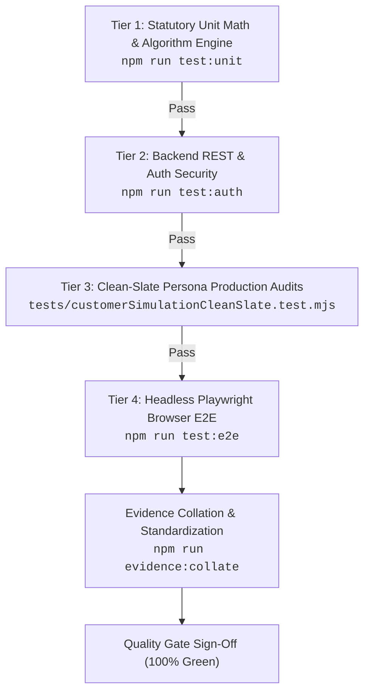

# Universal Autonomous Continuous Integration (CI) Engine

A complete, harness-agnostic specification for autonomous agents to execute, maintain, and evolve continuous integration pipelines. Designed for zero-downtime compliance, flake-free execution, and standardized visual evidence.

---

## 1. Multi-Tier Quality Gate Architecture

Every codebase validation cycle must progress through 4 hierarchical verification tiers. If an earlier tier fails, the pipeline halts immediately.



### Tier Specifications

| Tier | Focus | Execution Target | Typical Budget | Pass Criteria |
| :--- | :--- | :--- | :--- | :--- |
| **Tier 1: Unit & Math** | Pure business logic, tax math, gap detection, ERP normalizers, 4-tier fuzzy algorithms | Local Node process (`node --test`) | < 500ms | 100% deterministic mathematical accuracy |
| **Tier 2: REST & Security** | Endpoint contracts, HMAC challenge tokens, DPDP masking, injection defense | Local / Mock Express server | < 2.0s | Zero cleartext leaks, strict 401 on unauthorized attempts |
| **Tier 3: Production Persona Audit** | Clean-slate production validation, zero mock client leakage, carrier SMS integration | Live edge deployment (`clickncomply.shop`) | < 8.0s | Zero demo client leakage, active carrier verification |
| **Tier 4: Playwright E2E** | Multi-screen browser user journeys across CA, MSME, and Enterprise AP personas | Headless Chromium (1440x900 viewport) | < 60.0s | All assertions pass, DOM stability, visual trace captured |

---

## 2. Pacing, Human Observability & Flake Immunity

Machine-speed test runs cause visual teleportation in recordings and network flakes against distributed edge isolates. Autonomous harnesses must enforce the following runtime standards:

### A. Network Resilience & Edge Isolate Drift Defense
Never use raw `fetch()` against edge services or third-party gateways. Always use exponential retry with timeout abort controllers:

```javascript
async function fetchWithRetry(url, options = {}, retries = 2, delayMs = 1000) {
  for (let i = 0; i <= retries; i++) {
    try {
      const controller = new AbortController();
      const timeout = setTimeout(() => controller.abort(), 10000);
      const res = await fetch(url, { ...options, signal: controller.signal });
      clearTimeout(timeout);
      return res;
    } catch (err) {
      if (i === retries) throw err;
      await new Promise(r => setTimeout(r, delayMs * (i + 1)));
    }
  }
}
```

### B. Human Pacing & Observability
* **Standard Viewport**: 1440x900 resolution (`use: { viewport: { width: 1440, height: 900 } }`).
* **Visual Pacing**: For demonstration and review runs, set `slowMo: 300` to allow human comprehension.
* **Settle Delays**: Insert 500ms–800ms pauses after opening modals or rendering tables to capture clean visual evidence.

---

## 3. Evidence Collation & Standardization Pipeline

Raw browser recordings are uncompressed, downscaled, or fragmented. The CI engine automatically standardizes all visual artifacts into **VP9 WebM**:

### Encoding Profile
```bash
ffmpeg -y -i <raw_capture>.webm \
  -c:v libvpx-vp9 \
  -crf 30 \
  -b:v 0 \
  -cpu-used 4 \
  -row-mt 1 \
  -an \
  <output>_vp9.webm
```

* **Compression Ratio**: Produces ~70% reduction in file size (e.g., 3.6 MB down to 1.1 MB).
* **Speedup**: `-cpu-used 4 -row-mt 1` delivers 7x faster multi-threaded encoding.
* **Audio**: `-an` strips unnecessary audio streams for clean, minimal artifact size.

### Evidence Manifest Specification
All runs must compile an `evidence-manifest.json` indexing:
* Timestamp and test agent identity.
* Original vs VP9 WebM sizes and reduction percentages.
* Synchronized screenshots mapped to test stages.

### Reverse-Chronological Report Sorting (Latest First)
Playwright HTML reports bundle test executions in chronological order by default. The CI pipeline unpacks the embedded base64 zip archive, sorts test suites and individual stages descending by execution timestamp (`startTime`), repacks the zip, and patches `Hs.prototype.json()` to guarantee that the newest run is rendered at the top of the browser report.

---

## 4. Execution Commands

```bash
# 1. Execute complete test suite (Unit + Auth + Clean Slate)
npm test

# 2. Run Headless Playwright E2E Suite with auto-collation
npm run test:e2e

# 3. Manually trigger VP9 WebM transcode & HTML report latest-first sort
npm run evidence:collate

# 4. Run Headed E2E Suite for interactive inspection
npm run test:e2e:watch
```

---

## 5. Cross-Harness Training & Continuous Learning Protocol

To keep this capability evolving and automatically train other agent harnesses (Claude Code, Antigravity, Devin, Codex, GitHub Actions):

### Step 1: The Incident-to-Rule Ingestion Loop
Whenever a test failure, regression, or edge case is solved:
1. Identify the root cause category:
   - *Algorithmic Variance*: Add a new test case in Tier 1.
   - *Edge Drift / Timeout*: Wrap in `fetchWithRetry` pattern in Tier 3.
   - *Visual Flake*: Add settle delay or virtual cursor in Tier 4.
2. Update this `SKILL.md` with the newly established guardrail.
3. Record the lesson in the agent's durable `memory.md`.

### Step 2: Automated Skill Synchronization
Run the cross-harness skill sync tool to broadcast this updated capability across all active agent workspaces:

```bash
node scripts/syncSkills.mjs
```

This synchronizes `.agent/skills/continuous-integration/SKILL.md` to:
* `.claude/skills/continuous-integration/`
* `hive/agents/*/.claude/skills/continuous-integration/`
* `.cursor/skills/` and `.codex/` config trees.

### Step 3: Hive Outbox Broadcast
When an agent updates the CI capability, it drops an inform message to `god` or `broadcast`:
```json
{
  "to": "broadcast",
  "act": "inform",
  "subject": "CI Capability Updated: Added <feature_or_guardrail>",
  "body": "Updated .agent/skills/continuous-integration/SKILL.md and synchronized to all agent workspaces."
}
```
