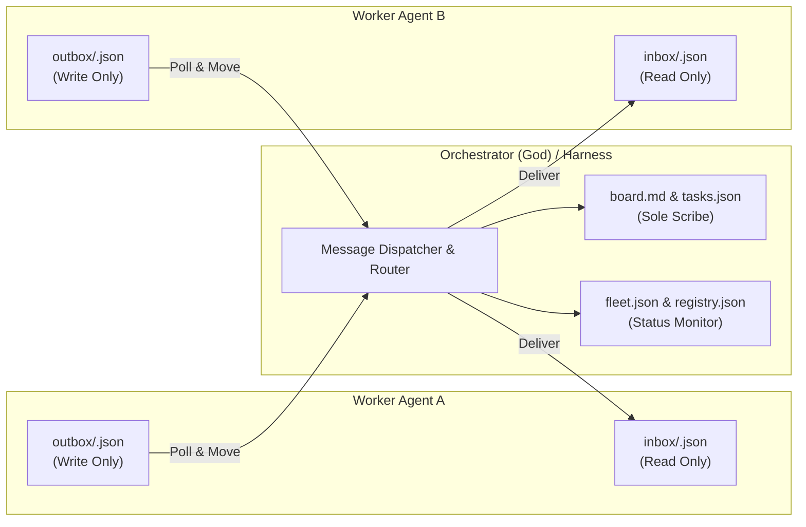
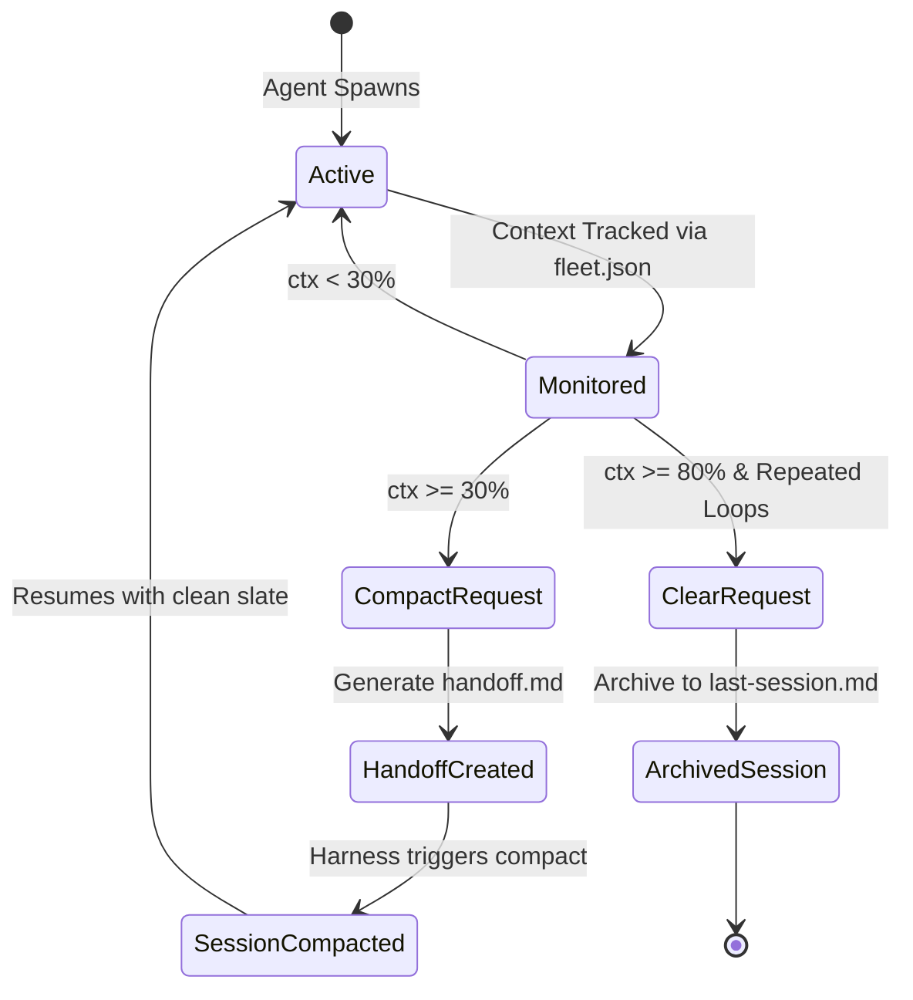

# Universal Multi-Agent Office & Hive Swarm Orchestration Engine

A complete, harness-agnostic specification for autonomous AI agent offices, multi-agent hives, and coordinator/orchestrator swarms. Designed for deadlock-free inter-agent communication, token budget stewarding, deterministic task decomposition, and graceful human-in-the-loop escalation.

---

## 1. Single-Writer File-Based Mailbox Architecture

To prevent race conditions, file locks, and state corruption across concurrent autonomous agents, inter-agent messaging strictly follows an **isolated, single-writer mailbox protocol**.



### Core Communication Rules
1. **Never Write Into Another Agent's Directory**: Agents write exclusively to their own private `outbox/`. The orchestrator/harness validates and moves the payload to the recipient's `inbox/`.
2. **Terminal vs. Conversational Acts**:
   - `request`, `query`, `propose` $\rightarrow$ Expect a response.
   - `inform`, `note`, `done` $\rightarrow$ **Terminal**. Never send a message that solely acknowledges or thanks, as two autonomous agents will loop infinitely.
3. **Envelope Schema**:
   ```json
   {
     "to": "<recipient-agent-id> | god | broadcast",
     "act": "request | inform | note | propose | query | agree | refuse | done",
     "subject": "Concise one-line summary",
     "body": "Detailed technical payload or contract",
     "work": "Ticket or task ID (e.g. GCA-102)",
     "conversation": "Unique thread correlation ID (optional)",
     "in_reply_to": "Parent message ID (optional)"
   }
   ```

---

## 2. Agent Lifecycle: Lasting Agents vs. Ephemeral Temps

Autonomous workforces are partitioned into two operational classes:

| Attribute | Lasting Agent (Permanent Staff) | Ephemeral Temp (Task Worker) |
| :--- | :--- | :--- |
| **Lifecycle** | Persists across restarts; lasting session and memory | Spun up for a single task and torn down upon completion |
| **Workspace** | Dedicated directory under `agents/<id>/` | Temporary directory / worktree under `projects/<id>` |
| **Memory** | Maintains cumulative `memory.md` and `handoff.md` | Reads memory index; outputs deliverables and branch report |
| **Git Scope** | Owns designated feature branch or main staging | Isolated git worktree (`isolate: true`); auto-commits on completion |
| **Use Case** | Domain specialists (QA Lead, Architecture Reviewer, Release Gate) | Discrete, parallelizable implementation jobs (e.g., test conversion, bugfix) |

### Dispatch Contract
Every task delegation from orchestrator to worker must contain four explicit sections:
1. **OBJECTIVE**: The unambiguous goal of the task.
2. **OUTPUT**: The expected deliverable and its format (files, branch, report).
3. **TOOLS**: Permitted tools, constraints, and reference documentation paths.
4. **BOUNDARIES**: Definition of Done (DoD), non-goals, and token caps.

---

## 3. Context Saturation & Compacting Lifecycle

Long-running agent conversations suffer cognitive degradation and prompt pollution when context windows exceed optimal thresholds.



### Handoff Protocol
Before compacting or clearing, the agent writes a structured handoff section into `handoff.md`:
```markdown
## <work-id> | <task-title>
_touched: 2026-11-24T22:00:00Z_
- **State**: Current execution state and passing tests.
- **Next**: Exact subsequent action required.
- **Files**: Modified file paths and active branches.
- **Open**: Unresolved blockers or pending questions.
```

---

## 4. Multi-Tier Circuit Breakers (Runaway Prevention)

To guard against runaway tool calls, hallucinated error loops, and budget exhaustion, a 3-tier circuit breaker monitors execution:

```
[Healthy] ─────────▶ [Steer] ─────────▶ [Constrain] ─────────▶ [Stop]
 Normal Op            Warning Prompt       Read-Only Gate         Session Halted
```

1. **Tier 1: `steer`**: Triggered when an agent repeats the same tool with identical or failing parameters twice. The harness injects a high-priority system intervention demanding an approach pivot.
2. **Tier 2: `constrain`**: Triggered after 4 consecutive failures or error storms. All write, execute, and remote tools are locked; the agent enters read-only mode and must report findings to the orchestrator.
3. **Tier 3: `stop`**: Hard abort. The agent process is suspended, and the card moves to `blocked` on the kanban board.

---

## 5. Bounded Human Escalation Protocol (ASK ME Cards)

When a blocker requires human intervention (e.g. credentials, payment authorization, physical device testing, or architectural trade-offs), agents must **never stall silently** or output open-ended chat prompts.

### Escalation Contract Rules:
- **Maximum Length**: Under 700 characters total.
- **Structure**:
  1. **One bold sentence** stating the exact requirement.
  2. Concise bullet points (`-`) or numbered options (`1.`).
  3. Structured options array for programmatic mobile approval:
     ```json
     {
       "q": "**Select target environment for staging deployment:**",
       "options": [
         { "label": "Cloudflare Pages Preview", "detail": "Zero risk isolated preview" },
         { "label": "Direct Production Edge", "detail": "Promote to live clickncomply.shop" }
       ],
       "recommended": 0,
       "multi": false
     }
     ```
- **Asynchronous Execution**: The agent never idles waiting for human answers. The task card is set to `"status": "blocked"` with `humanQA` appended, and the agent proceeds to other decoupled tasks.

---

## 6. Learnings & Discovered Edge Cases

- **2026-11-24 [Single-Writer File Locks on Windows]**: Concurrently appending to a shared log file across multiple background agent processes on Windows triggers `EBUSY` / `EPERM` lock violations. Enforce atomic writes: each message must be written as a distinct, randomly UUID-named `.json` file inside the agent's private directory.
- **2026-11-24 [Terminal Ack Loops]**: When agents send courtesy acknowledgments (e.g. `{"act": "inform", "body": "Thank you, starting work"}`), downstream agents often reflexively reply with `{"act": "inform", "body": "You are welcome"}`. The router must enforce a strict prohibition on non-functional acknowledgment messages.
- **2026-11-24 [Context Degradation In Worktrees]**: Long-running background temps operating in isolated git worktrees will silently fail if untracked files are left uncommitted during teardown. Orchestrators must enforce a clean teardown hook that commits dirty worktree state to a salvage branch before deleting the temp container.
