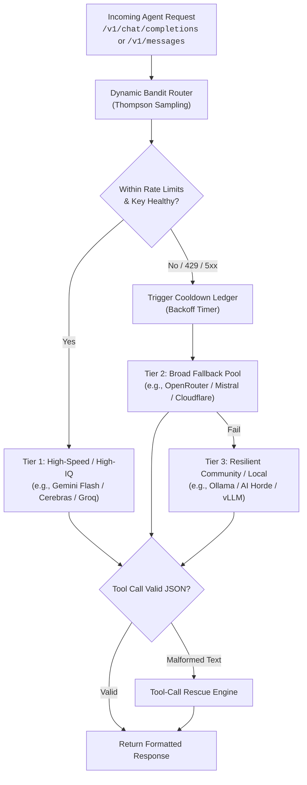

# Universal Resilient LLM Routing & Gateway Architecture

A robust, harness-agnostic specification for autonomous agents to route, arbitrate, and fallback across heterogeneous LLM endpoints (commercial, free-tier, and self-hosted). Designed for zero-downtime execution, automatic rate-limit recovery, and universal wire-format compatibility.

---

## 1. Multi-Provider Fallback & Dynamic Routing Architecture

Autonomous workflows must never depend on a single LLM provider endpoint. When a provider encounters rate limits (`429`), temporary degradation (`503`), or cloud outages, the gateway dynamically reroutes requests down a prioritized fallback chain.



---

## 2. Thompson-Sampling Bandit Scoring

Instead of naive round-robin or static priority arrays, the router continuously evaluates each model endpoint across three live dimensions:
1. **Intelligence & Output Quality ($Q$)**: Tracked via benchmark weights or historical pass rates.
2. **Latency & Throughput ($S$)**: Moving average time-to-first-token (TTFT) and tokens per second.
3. **Availability & Reliability ($R$)**: Success ratio over a sliding 15-minute window.

### Scoring Formula
$$\text{Score} = w_q \cdot Q + w_s \cdot S + w_r \cdot R - \text{Penalty}_{\text{cooldown}}$$

Endpoints are sampled probabilistically using Beta distributions parameterizing successes $(\alpha)$ and failures $(\beta)$:
$$\theta \sim \text{Beta}(\alpha + 1, \, \beta + 1)$$

---

## 3. Sliding-Window Rate-Limit & Cooldown Ledger

To prevent cascading account bans and perpetual `429` storming, the gateway maintains an in-memory sliding-window counter backed by persistent storage (SQLite/Redis):

| Metric | Scope | Tracking Window | Action on Threshold Exceeded |
| :--- | :--- | :--- | :--- |
| **RPM** (Requests Per Minute) | `(provider, model, key)` | Rolling 60 seconds | Queue request or spill over to next provider |
| **RPD** (Requests Per Day) | `(provider, model, key)` | Rolling 24 hours / UTC day | Mark endpoint `exhausted` until UTC 00:00 |
| **TPM** (Tokens Per Minute) | `(provider, model, key)` | Rolling 60 seconds | Throttle request pre-flight based on prompt size |
| **TPD** (Tokens Per Day) | `(provider, model, key)` | Rolling 24 hours / UTC day | Graceful degradation to secondary model tier |

### Cooldown Policy
When an HTTP `429 Too Many Requests` or `5xx` is encountered:
1. Immediately increment the failure count for that `(provider, key)` tuple.
2. Apply an exponential cooldown:
   $$T_{\text{cooldown}} = \min(T_{\text{base}} \cdot 2^{\text{retries}}, \, T_{\text{max}})$$
   *(Default: $T_{\text{base}} = 15\text{s}$, $T_{\text{max}} = 300\text{s}$)*.
3. Remove the endpoint from the active routing pool until $T_{\text{cooldown}}$ elapses.
4. Retry the in-flight request immediately against the next healthy candidate in the chain.

---

## 4. Tool-Call Rescuing Engine

Smaller, quantized, or free-tier models frequently struggle with strict JSON function calling, dumping tool calls as plaintext markdown code blocks, XML tags, or raw stringified arguments.

The **Tool-Call Rescuer** intercepts responses before returning them to the agent harness:

```javascript
/**
 * Normalizes malformed model output into valid OpenAI/Anthropic tool_calls.
 */
function rescueToolCall(rawContent, declaredTools) {
  if (!rawContent || typeof rawContent !== 'string') return null;

  // Regex 1: JSON block containing function name and arguments
  const jsonBlockRegex = /```(?:json)?\s*(\{[\s\S]*?"name"[\s\S]*?"arguments"[\s\S]*?\})\s*```/i;
  // Regex 2: XML style function invocation <tool_call>...</tool_call>
  const xmlBlockRegex = /<tool_call>([\s\S]*?)<\/tool_call>/i;

  let candidate = null;
  const jsonMatch = rawContent.match(jsonBlockRegex);
  const xmlMatch = rawContent.match(xmlBlockRegex);

  if (jsonMatch) {
    try { candidate = JSON.parse(jsonMatch[1]); } catch (_) {}
  } else if (xmlMatch) {
    try { candidate = JSON.parse(xmlMatch[1].trim()); } catch (_) {}
  }

  if (candidate && candidate.name) {
    const isDeclared = declaredTools.some(t => (t.function?.name || t.name) === candidate.name);
    if (isDeclared) {
      return [{
        id: `call_${Math.random().toString(36).substring(2, 11)}`,
        type: 'function',
        function: {
          name: candidate.name,
          arguments: typeof candidate.arguments === 'string' 
            ? candidate.arguments 
            : JSON.stringify(candidate.arguments || {})
        }
      }];
    }
  }

  return null;
}
```

---

## 5. Multi-Protocol Wire Translation

Agents and harnesses speak different native dialects. The gateway normalizes across them:

1. **OpenAI Standard (`/v1/chat/completions`)**: The universal baseline format.
2. **Anthropic Messages API (`/v1/messages`)**:
   - Converts system messages from array elements to root `system` parameters.
   - Translates `tool_use` and `tool_result` content blocks to/from standard `tool_calls`.
3. **Gemini API (`/v1beta/models/...:generateContent`)**:
   - Converts `messages` into `contents` with roles `user` and `model`.
   - Maps `tools` into `functionDeclarations`.

---

## 6. Security & Key Envelope Encryption

- Never store provider API keys in plain text.
- Use **AES-256-GCM** envelope encryption with a unique initialization vector (IV) and authentication tag for each stored credential.
- Key decryption occurs in memory strictly at the time of outbound provider dispatch and is wiped immediately after request completion.

---

## 7. Learnings & Discovered Edge Cases

- **2026-11-24 [Token Counter Drift]**: Token estimation using character-based heuristics (`charCount / 4`) underestimates prompt size for Asian scripts, code with dense indentation, and structured JSON payloads by up to 35%. Always use a tokenizer matching the model family (e.g., tiktoken for OpenAI/Claude, SentencePiece for Gemini) when enforcing TPM/TPD caps.
- **2026-11-24 [HTTP 429 Header Variance]**: Different providers signal rate limits differently. Groq and Cerebras return `retry-after` in seconds, OpenAI uses seconds, while others omit the header entirely. Always default to exponential backoff when `retry-after` is missing or unparseable.
- **2026-11-24 [Streaming Chunk Normalization]**: Some free-tier upstream providers drop final usage metrics (`usage.total_tokens`) in streaming SSE events. Always maintain a local chunk counter to provide accurate fallback telemetry when upstream usage blocks are absent.
